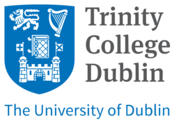

## Overview
DISCLOSE (Distributed Sensing and Collaborative Optimisation for Smart Energy-efficient Buildings) is led by Trinity College Dublin and aims to create an automated, intelligent energy management framework that allows everyday household devices to independently monitor and optimise their electricity usage.

At present, homeowners who want to benefit from smart metering and time-of-day billing often need to manually schedule appliance usage or invest in expensive centralised systems that require extensive retrofits and can raise data privacy concerns. DISCLOSE addresses these challenges by developing a localised automation system in which devices securely coordinate their energy consumption without sharing personal data with external energy providers or grid operators.

This privacy-preserving approach aims to help consumers lower their energy bills, improve the resilience of the national electric grid, and support a wider transition to sustainable, energy-efficient homes.

## News
- 2026/11/17: Kick-off meeting is scheduled.
- 2026/11/01: Priyanti Mandal joins the project. Priyanti will be pursing a PhD under Prof. Biswajit Basu, and her research focuses on novel control strategies for DISCLOSE.
- 2026/09/01: Jiaao Yu joins the project. Jiaao will be pursuing a PhD at RCSL working on the energy management framework using neuromorphic approaches and novel consensus strategies. 

## Research Approach
The project moves away from traditional centralised home energy management towards a distributed consensus model. By leveraging lightweight consensus algorithms and flexible smart contracts, connected devices will be able to securely aggregate consumption data and collaboratively determine optimal control schedules in real time.

The system is also designed to adapt automatically to human-driven interactions and overrides. For smart home system design, this enables granular, automated demand-side management using the existing computational capabilities of modern devices over standard wireless interfaces, reducing the need for expensive hardware retrofits or subscription-based cloud analytics.

## Technical Direction
DISCLOSE develops a distributed consensus model for home energy management, moving away from traditional centralised systems. The project investigates lightweight consensus algorithms and flexible smart contracts that allow connected devices to securely aggregate local consumption data and collaboratively determine optimal control schedules in real time.

The framework is designed to remain responsive to human interactions and manual overrides, allowing automated schedules to adapt when residents change device usage. By using the existing computational capabilities of modern devices over standard wireless interfaces, DISCLOSE enables granular demand-side management without expensive hardware retrofits or reliance on subscription-based cloud analytics.

## Members
 

## Acknowledgments
This work was supported by the Sustainable Energy Authority of Ireland (SEAI) under Grant number 25/RDD/1351.

